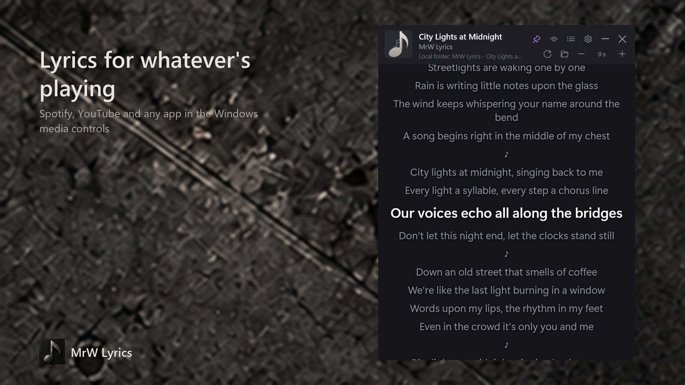
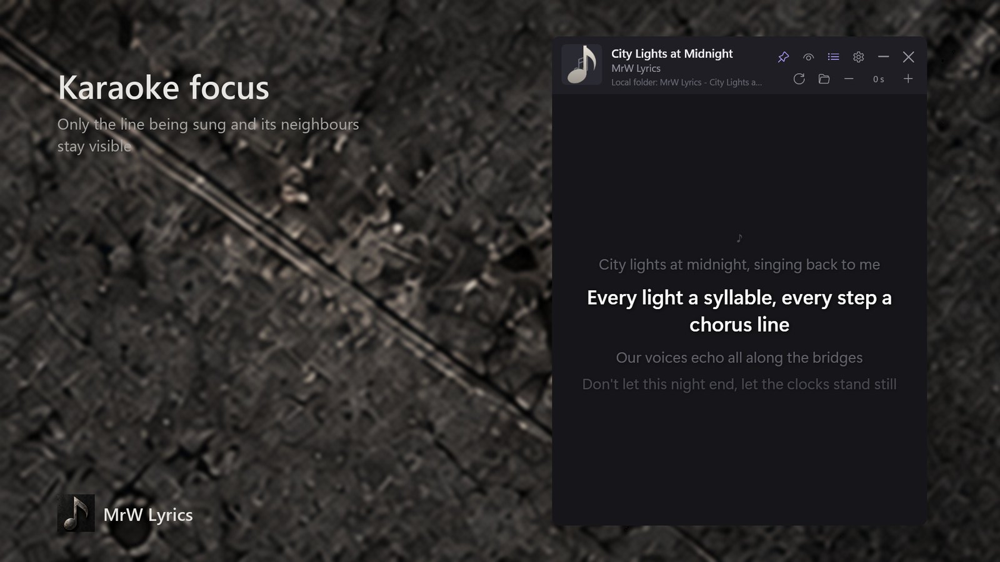
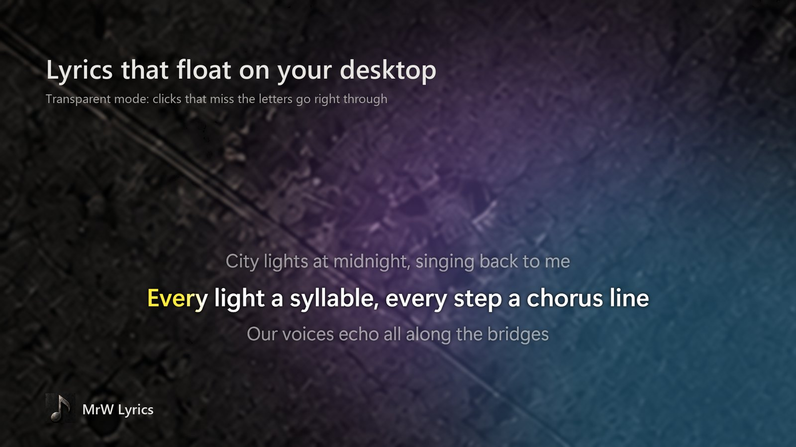
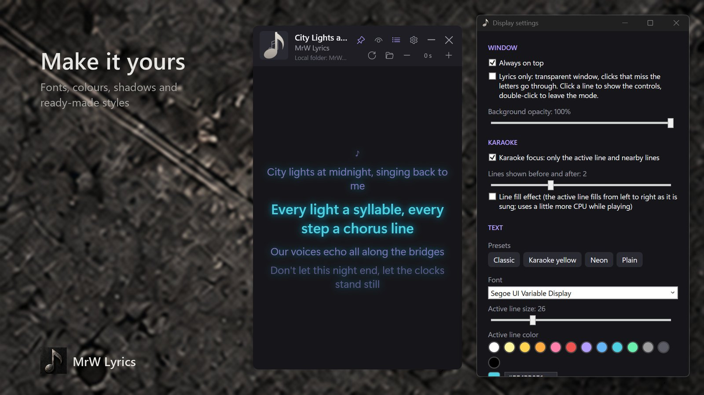

<p align="center">
  
</p>

<h1 align="center">MrW Lyrics</h1>

<p align="center">
  Synced lyrics for whatever is playing on Windows.<br>
  Karaoke focus, a transparent mode that floats on your desktop, and full styling. No sign-up, no ads.
</p>

<p align="center">
  <a href="https://apps.microsoft.com/detail/9N5X2VHWXJWQ"></a>
</p>

<p align="center">
  <a href="https://lyrics.mrwproject.com/">Website</a> ·
  <a href="https://lyrics.mrwproject.com/privacy/">Privacy</a> ·
  <a href="README.tr.md">Türkçe</a>
</p>

| | |
|---|---|
|  |  |
|  |  |

## Features

- **Detects the song that is playing** in Spotify, YouTube in your browser, Windows Media Player and any other app that shows up in the Windows media controls. Nothing to configure.
- **Synced lyrics**: the line being sung is highlighted and the window scrolls along. An optional fill effect sweeps across the line as it is sung.
- **Karaoke focus**: only the current line and its neighbours stay on screen.
- **Lyrics-only mode**: the window turns fully transparent and the lyrics float on your desktop. Clicks that miss the letters go through to the window behind; click a line to bring the controls back.
- **Styling**: font, size, colours, shadow or glow, background opacity, always on top, plus ready-made styles (Classic, Karaoke yellow, Neon, Plain).
- **Time offset** in half-second steps when the lyrics run ahead of or behind the song.
- **Recognizes re-uploads**: when no source has the lyrics (a video uploaded under someone else's name, for example), the app listens to the player for a few seconds and asks Shazam for the real song name, then searches again. Only a fingerprint of the sound is sent, once per song. Can be turned off in settings.
- **Offline replays**: lyrics that are found are saved to `Music\Lyrics` as `.lrc` / `.txt`. You can drop your own `.lrc` files there too.
- **English and Turkish** interface, following your Windows language.
- **Light and private**: no account, no telemetry, no microphone, no global keyboard or mouse hooks. Sound is only listened to for song recognition, and never saved or sent.

## How it works

1. The app listens to the Windows media session (System Media Transport Controls, the same data as the media flyout) and reacts to its events. There is no polling loop.
2. Titles from video sites are cleaned up ("(Official Video)", "Artist - Topic", "ArtistVEVO", …) before the search.
3. Lyrics are looked up in order: your local folder, [LrcLib](https://lrclib.net), Musixmatch, Genius and lyrics.ovh. Synced lyrics win; plain lyrics are kept while the remaining sources are asked for a synced version. Only the title, artist, album and length of the song are sent.
4. If nothing is found, the player's sound is captured for 3 to 12 seconds (only the player's own process tree on Windows 10 2004 and later), turned into a Shazam fingerprint in memory and sent to Shazam. The recognised name is searched again, and the lyrics are saved under the name the player reports, so the next play finds them locally without listening again.
5. The playback position is extrapolated from the last position the player reported, so the highlighted line stays in time between updates.

Lyrics are provided by these third-party services and remain the property of their respective owners. Sources can be turned off in `%APPDATA%\LyricsApp\settings.json` (`EnabledProviders`).

## Build from source

Requirements: Windows 10 1809 or later and the [.NET 10 SDK](https://dotnet.microsoft.com/download).

```bash
dotnet run --project src/LyricsApp
```

```bash
dotnet test
```

The diagnostic tool prints what is playing and what the lyrics sources return (line counts and timing only, never the lyrics):

```bash
dotnet run --project tools/LyricsApp.Probe
```

```bash
dotnet run --project tools/LyricsApp.Probe -- --provider lrclib "Artist" "Title"
```

MSIX packaging and the Store release workflow: [docs/store-packaging.md](docs/store-packaging.md), [docs/releases/README.md](docs/releases/README.md).

## Project layout

| Path | Contents |
|---|---|
| `src/LyricsApp.Core` | LRC parser, title cleaner, track matcher, lyrics sources, `LyricsService` |
| `src/LyricsApp.Media` | Windows media session watcher (event-driven) |
| `src/LyricsApp` | WPF app, localization, MSIX manifest and assets |
| `tests/` | xUnit tests |
| `tools/LyricsApp.Probe` | Command-line diagnostic tool |
| `tools/Packaging` | MSIX, Store images and screenshot scripts |
| `docs/` | Packaging, release rules, Store listing texts, privacy policy |

## License

[MIT](LICENSE)
