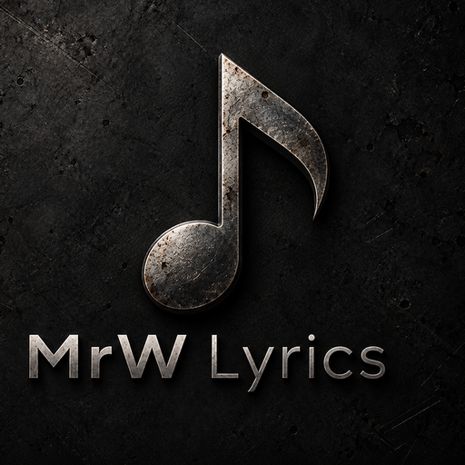
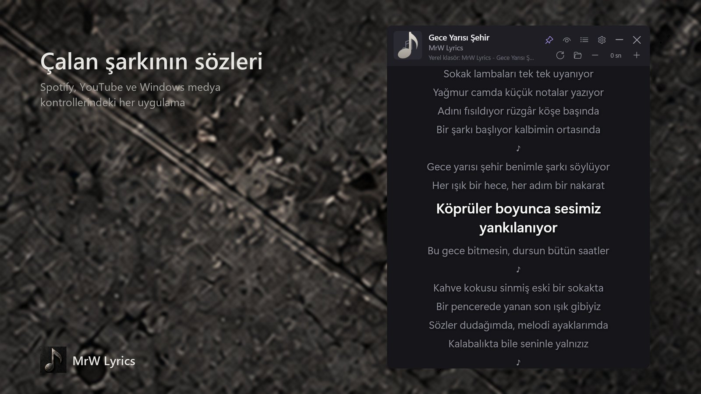
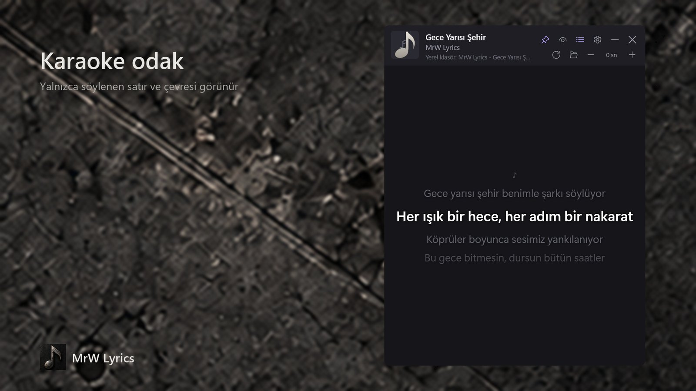
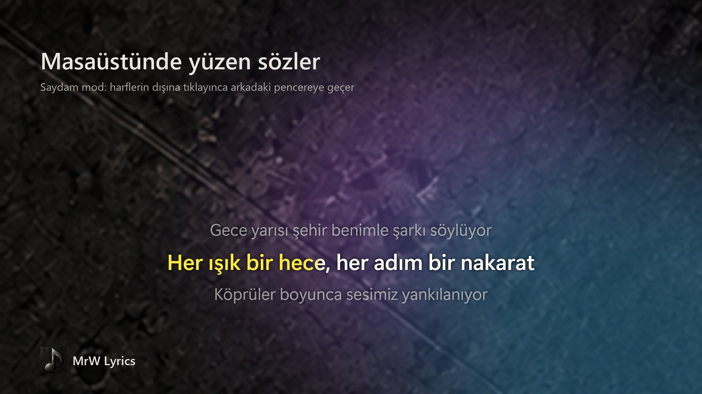
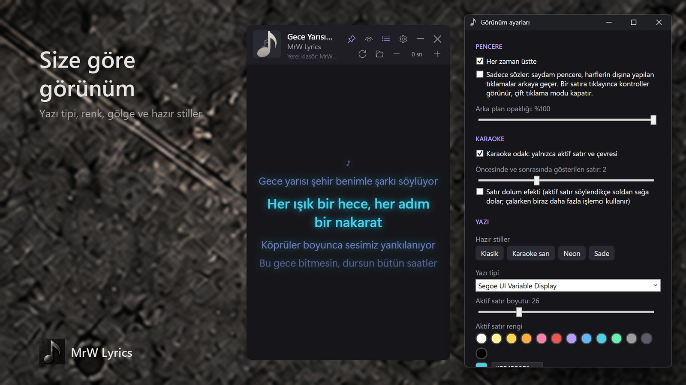

<p align="center">
  
</p>

<h1 align="center">MrW Lyrics</h1>

<p align="center">
  Windows'ta çalan şarkının sözleri, şarkıyla birlikte.<br>
  Karaoke odak, masaüstünde yüzen saydam mod ve tam görünüm özelleştirmesi. Üyelik yok, reklam yok.
</p>

<p align="center">
  <a href="https://apps.microsoft.com/detail/9N5X2VHWXJWQ"></a>
</p>

<p align="center">
  <a href="https://lyrics.mrwproject.com/">Web sitesi</a> ·
  <a href="https://lyrics.mrwproject.com/privacy/">Gizlilik</a> ·
  <a href="README.md">English</a>
</p>

| | |
|---|---|
|  |  |
|  |  |

## Özellikler

- **Çalan şarkıyı kendiliğinden bulur**: Spotify, tarayıcıda YouTube, Windows Medya Oynatıcısı ve Windows medya kontrollerinde görünen diğer uygulamalar. Ayar gerekmez.
- **Senkron sözler**: o an söylenen satır vurgulanır, pencere şarkıyla birlikte kayar. İsterseniz satır, söylendikçe soldan sağa dolar.
- **Karaoke odak**: yalnızca söylenen satır ve çevresindeki satırlar ekranda kalır.
- **Sadece sözler modu**: pencere tamamen saydamlaşır ve sözler masaüstünde yüzer. Harflerin dışına yapılan tıklamalar arkadaki pencereye geçer. Bir satıra tıklayınca kontroller geri gelir.
- **Görünüm**: yazı tipi, boyut, renkler, gölge ya da parlama, arka plan opaklığı, her zaman üstte. Hazır stiller de var: Klasik, Karaoke sarı, Neon, Sade.
- **Zaman kaydırma**: sözler şarkının önünde ya da gerisinde kalırsa yarım saniyelik adımlarla düzeltin.
- **Başka adla yüklenmiş şarkıları da tanır**: hiçbir kaynakta söz bulunamazsa (örneğin başkasının adıyla yüklenmiş bir video) uygulama oynatıcıyı birkaç saniye dinler, Shazam'dan şarkının gerçek adını öğrenir ve yeniden arar. Yalnızca sesin parmak izi gönderilir, her şarkı için bir kez. Ayarlardan kapatılabilir.
- **Tekrar dinlemede internet gerekmez**: bulunan sözler `Müzik\Lyrics` klasörüne `.lrc` / `.txt` olarak kaydedilir. Kendi `.lrc` dosyalarınızı da bu klasöre koyabilirsiniz.
- **Türkçe ve İngilizce** arayüz, Windows dilinize göre açılır.
- **Hafif ve gizliliğe saygılı**: hesap yok, telemetri yok, mikrofon yok, sistem genelinde klavye ya da fare kancası yok. Ses yalnızca şarkı tanıma için dinlenir; kaydedilmez ve gönderilmez.

## Nasıl çalışır

1. Uygulama Windows medya oturumunu (System Media Transport Controls, medya açılır penceresiyle aynı bilgi) dinler ve olaylarına tepki verir. Sürekli yoklama yapmaz.
2. Video sitelerinden gelen başlıklar aramadan önce temizlenir ("(Official Video)", "Sanatçı - Topic", "SanatçıVEVO" vb.).
3. Sözler sırayla aranır: yerel klasörünüz, [LrcLib](https://lrclib.net), Musixmatch, Genius ve lyrics.ovh. Senkron söz önceliklidir; yalnızca düz metin bulunursa senkron sürüm için diğer kaynaklara sorulmaya devam edilir. Gönderilen tek bilgi şarkının adı, sanatçısı, albümü ve süresidir.
4. Hiçbir şey bulunamazsa oynatıcının sesi 3 ile 12 saniye arası dinlenir (Windows 10 2004 ve sonrasında yalnızca oynatıcının kendi süreçleri), bellekte Shazam parmak izine çevrilir ve Shazam'a gönderilir. Tanınan adla yeniden aranır. Sözler oynatıcının bildirdiği adla kaydedilir, böylece şarkı bir daha çaldığında ne internet ne de dinleme gerekir.
5. Çalma konumu, oynatıcının bildirdiği son konumdan ileriye doğru hesaplanır. Böylece güncellemeler arasında da vurgulanan satır şarkıyla uyumlu kalır.

Şarkı sözleri bu üçüncü taraf servislerden gelir ve hakları sahiplerine aittir. Kaynaklar `%APPDATA%\LyricsApp\settings.json` dosyasındaki `EnabledProviders` listesinden kapatılabilir.

## Kaynaktan derleme

Gerekenler: Windows 10 1809 veya üstü ve [.NET 10 SDK](https://dotnet.microsoft.com/download).

```bash
dotnet run --project src/LyricsApp
```

```bash
dotnet test
```

Teşhis aracı çalan şarkıyı ve söz kaynaklarının sonucunu yazar (yalnızca satır sayısı ve zamanlama, söz metni asla):

```bash
dotnet run --project tools/LyricsApp.Probe
```

```bash
dotnet run --project tools/LyricsApp.Probe -- --provider lrclib "Sanatçı" "Şarkı"
```

MSIX paketleme ve Store sürüm süreci: [docs/store-packaging.md](docs/store-packaging.md), [docs/releases/README.md](docs/releases/README.md).

## Proje yapısı

| Yol | İçerik |
|---|---|
| `src/LyricsApp.Core` | LRC ayrıştırıcı, başlık temizleyici, şarkı eşleştirici, söz kaynakları, `LyricsService` |
| `src/LyricsApp.Media` | Windows medya oturumu dinleyicisi (olay tabanlı) |
| `src/LyricsApp` | WPF uygulaması, çeviriler, MSIX manifesti ve görselleri |
| `tests/` | xUnit testleri |
| `tools/LyricsApp.Probe` | Komut satırı teşhis aracı |
| `tools/Packaging` | MSIX, Store görselleri ve ekran görüntüsü betikleri |
| `docs/` | Paketleme, sürüm kuralları, Store listeleme metinleri, gizlilik politikası |

## Lisans

[MIT](LICENSE)
